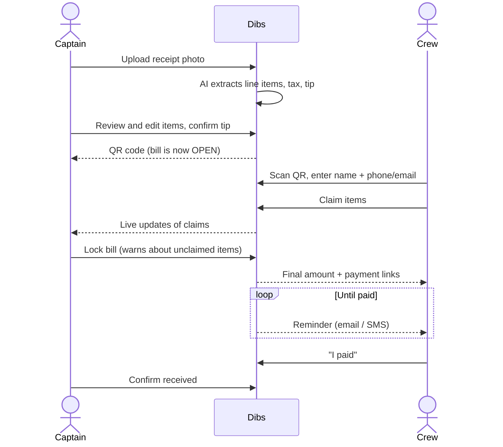
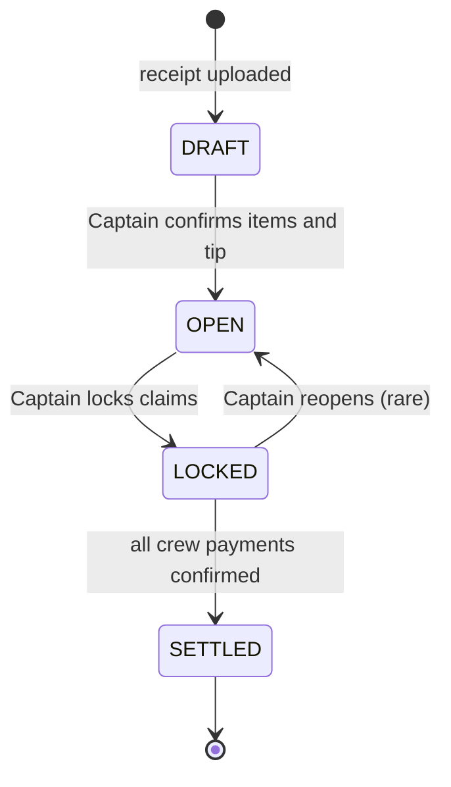
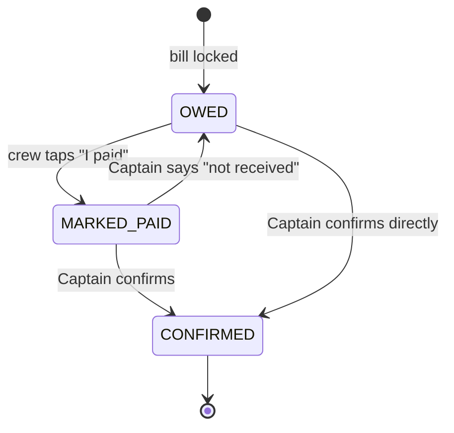
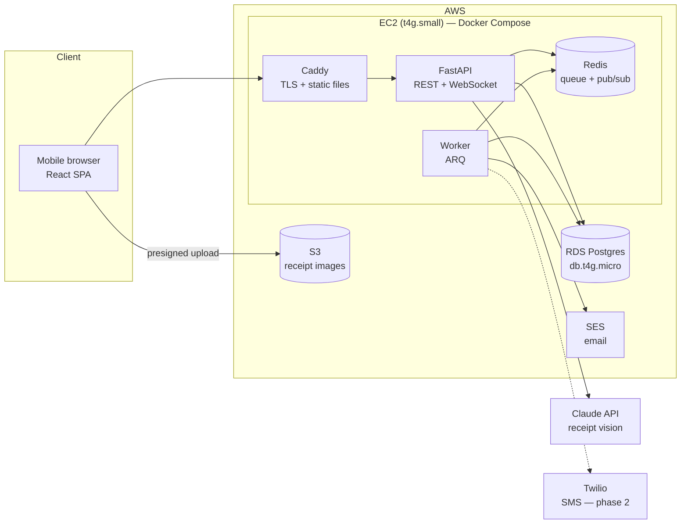
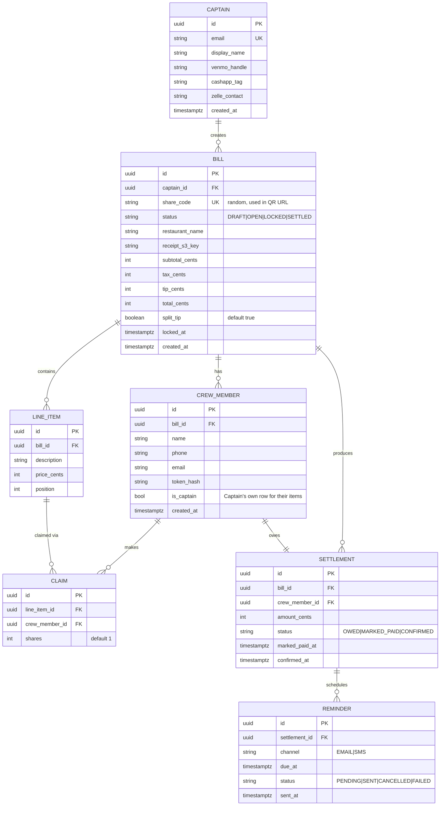

# Dibs — Design Document

> Split the bill at the table. Snap the receipt, share a QR, everyone calls dibs on what they ordered, and Dibs chases the payments so you don't have to.

**Status:** Draft v0.1
**Last updated:** 2026-10-26

---

## 1. Overview

When a group eats out, one person often pays the whole bill and then has to collect from everyone else. That is tedious (who had what?) and awkward (chasing friends for $14.50).

Dibs fixes both problems:

1. The **Captain** pays the bill and photographs the receipt.
2. AI reads the receipt into line items, including tax and tip.
3. Dibs generates a **QR code**. The **Crew** scan it and call "dibs" on what they ordered.
4. Each crew member sees exactly what they owe, including their share of tax and tip, with one-tap links to pay the Captain via Venmo, Cash App or Zelle.
5. Dibs sends **reminders** until the Captain confirms they've been paid.

Dibs **never handles money**. It only tracks who owes what and nudges people to pay.

## 2. Goals and non-goals

### Goals
- A crew member can go from scanning the QR to knowing exactly what they owe in **under 60 seconds**, with **no account**.
- The Captain never has to do math or send an awkward "hey, you owe me" text.
- Amounts are always exact: shares add up to the bill total to the cent.
- Mobile-first web app; no app store install.

### Non-goals (v1)
- Processing or holding payments.
- Native iOS/Android apps.
- Splitting expenses outside restaurants (trips, rent, etc.).
- Monetization. Dibs is free; see [§13](#13-cost-and-monetization).

## 3. Users and roles

| Role | Account? | Identity |
|---|---|---|
| **Captain** | Yes | Email login. Stores payment handles (Venmo, Cash App, Zelle) once. |
| **Crew** | No | Name plus phone **or** email, entered when joining a bill. Gets a bill-scoped access token. |

## 4. User stories

**Captain**
- As the Captain, I pay the full bill, photograph the receipt, and get a QR code to share with the table.
- As the Captain, I can review and correct the AI's reading of the receipt before sharing it.
- As the Captain, I can confirm the tip the AI detected or enter it manually.
- As the Captain, I can untick "Also split the tip" to cover the whole tip myself. It is ticked by default.
- As the Captain, I see in real time who has claimed what and what each person owes.
- As the Captain, I'm warned clearly about any unclaimed items, which default to me unless I assign them.
- As the Captain, I mark each person as paid when the money arrives.
- As the Captain, Dibs reminds people to pay so I don't have to.

**Crew**
- As a crew member, I scan the QR, enter my name and contact info, and claim my items.
- As a crew member, I can share an item (such as an appetizer) with others.
- As a crew member, I see a clear breakdown: my items, my share of tax and tip, and my total.
- As a crew member, I can pay with one tap (a prefilled Venmo or Cash App link, or the Captain's Zelle info) and mark myself as paid.

## 5. Core flow



## 6. Bill lifecycle



- **DRAFT:** the AI has parsed the receipt and the Captain is reviewing it. Not visible to the crew.
- **OPEN:** the QR is live and the crew can join and claim. Amounts update live as people join shared items.
- **LOCKED:** claims are frozen and final amounts are computed. Unclaimed items are assigned to the Captain, who is warned prominently first. Reminders start.
- **SETTLED:** every crew member's payment has been confirmed.

**Why a lock step?** If amounts were final the moment someone claimed, a person joining the nachos later would silently change everyone else's total. Locking gives a single moment where amounts become final, and that is when crew members are told what they owe.

## 7. Payment status (per crew member)



Reminders are sent only while the status is **OWED**. When a crew member marks themselves as paid, the Captain gets a notification to confirm.

## 8. Money math

All money is stored as **integer cents**. Floats are never used for money.

### Shared items
- Each claim has a **share count** (default `1`). An item's price is split between its claimers in proportion to their shares.
- Two people on the nachos with 1 share each split 50/50. Uneven splits need no extra modelling: give one person 2 shares.
- Receipt lines with a quantity (`3 × Beer  $18.00`) are expanded into separate units (`Beer $6.00` × 3) so people claim whole units.

### Tax and tip
Tax and tip are allocated **in proportion to each person's item subtotal**. If your items make up 20% of the subtotal, you pay 20% of the tax and 20% of the tip.

Tax is always split. The tip is split by default, but the Captain can turn that off (`split_tip`) to cover the whole tip themselves.

The tip is read from the receipt when it is present. The Captain confirms it or enters it manually.

Discounts and service charges on the receipt are treated the same way as tax: allocated in proportion to subtotal. *(Open question, see §16.)*

### Rounding: largest remainder method
Proportional splits produce fractions of a cent. To make shares add up to the total exactly:

1. Compute each person's exact share and round it **down** to the cent.
2. Work out how many cents are left over (`total - sum(rounded shares)`).
3. Give one extra cent to each person with the largest fractional remainder until none are left. Ties go to the Captain.

**Example:** $10.00 split 3 ways gives $3.33 / $3.33 / $3.34. The total is always exactly right.

### Unclaimed items
At lock time, any unclaimed item is assigned to the Captain unless the Captain assigns it to someone else. The lock screen lists unclaimed items **prominently** and requires explicit confirmation.

## 9. Architecture

### v1: lean deployment



### Components

| Component | Responsibility |
|---|---|
| **React SPA** | Captain and crew UIs. Mobile-first. Uses the camera through the browser file input. |
| **FastAPI** | REST API, WebSocket endpoint for live bill updates, auth, money math, calls to receipt parsing. |
| **Worker (ARQ)** | Async background jobs: receipt parsing (if slow), sending reminders and notifications. |
| **Redis** | Job queue, plus pub/sub for WebSocket fan-out between API instances. |
| **Postgres** | The single source of truth. |
| **S3** | Receipt images. Uploaded directly from the browser with presigned URLs. Deleted automatically by a lifecycle rule. |
| **SES** | Transactional email (reminders, "you've been paid" notices, Captain login links). |

### Design principles (why it can scale later)
- **Stateless API.** No in-memory sessions and no local file storage. Any number of API containers can run behind a load balancer.
- **12-factor config.** All configuration comes from environment variables. The same Docker image runs locally, on EC2, or on ECS.
- **WebSocket fan-out through Redis pub/sub.** A claim handled by API instance A reaches a Captain connected to instance B.
- **The database is the source of truth for reminders.** The queue only does delivery (see §11), so lost jobs or restarts don't cause missed or duplicate reminders.
- **Infrastructure as code.** All AWS resources are defined in Terraform.

### Scaling path

| Stage | Change | App code changes? |
|---|---|---|
| **v1 (now)** | Single EC2 instance + RDS micro | — |
| **Real users** | Containers move to ECS Fargate behind an ALB; Redis moves to ElastiCache; the SPA is served from S3 + CloudFront | No |
| **Lots of users** | Autoscaling on ECS, RDS read replicas, separate worker scaling | No |

## 10. Receipt parsing

1. The browser asks the API for a **presigned S3 URL** and uploads the photo directly to S3. Large images never pass through the API.
2. The API sends the image to **Claude (vision)** and asks for **structured output** that matches a strict JSON schema: restaurant name, line items (description, quantity, unit price), subtotal, tax, tip, total.
3. The response is validated with **Pydantic**, then checked against itself:
   - Do the line items add up to the subtotal?
   - Does subtotal + tax + tip equal the total?
4. Any mismatch is **flagged on the Captain's review screen** rather than silently "fixed". The Captain can edit, add or remove any item before opening the bill.

The model is configurable (`RECEIPT_MODEL` env var). The default is the current Claude Sonnet model, which balances accuracy and cost.

**Abuse and cost control:** parsing costs money per call, so scans are rate-limited per Captain (for example, 20 per day) and the image size is capped.

## 11. Notifications and reminders

### Channels
- **Phase 1: email (SES).** Cheap, with no carrier registration needed.
- **Phase 2: SMS (Twilio).** In the US this requires A2P 10DLC or toll-free number verification. We start that paperwork early but don't block v1 on it.

### Reminder schedule
When a bill is locked, each crew member gets a summary immediately. While their status is still `OWED`, reminders follow at **+24h, +3 days and +7 days**, and then stop. The Captain can also send a manual "nudge", limited to once per 24h per person.

### Implementation
- A `reminders` table stores each scheduled reminder (`due_at`, `status`).
- A periodic worker task (every minute) selects due reminders with `SELECT ... FOR UPDATE SKIP LOCKED`, sends them, and marks them sent. This is **idempotent and safe** with several workers, and survives restarts.
- Every message includes an unsubscribe / stop link. The SMS flow honours STOP keywords (TCPA compliance).

## 12. Real-time updates

- One WebSocket channel per bill: `bill:{id}`.
- When a claim changes, the API writes to Postgres, then publishes an event to Redis. Each API instance forwards it to the clients connected to that bill.
- The client also refetches the bill on reconnect, so a missed event never leaves the screen out of date.

## 13. Cost and monetization

Dibs is **free**. v1 runs on a lean setup:

| Item | Est. monthly cost |
|---|---|
| EC2 t4g.small | ~$12 |
| RDS db.t4g.micro (Postgres) | ~$12–15 |
| S3, SES, Route 53 | ~$1–2 |
| Claude API | ~1–2¢ per receipt |
| **Total (light use)** | **~$25–30** |

*These are estimates; check current AWS pricing. An AWS Budget alarm is set up on day one.*

**Monetization (not built in v1):** ads are deliberately left out because they would hurt trust on a payments screen. If Dibs ever needs revenue, a freemium Captain tier (saved groups, bill history, recurring dinners) is the natural option.

## 14. Data model



Notes:
- The Captain also gets a `CREW_MEMBER` row on each bill, so their own items are claimed the same way as everyone else's.
- `SETTLEMENT` rows are created at lock time. Before that, amounts are computed live from claims.
- A unique constraint on `(line_item_id, crew_member_id)` stops a person claiming the same item twice.

## 15. Security and privacy

- **Share codes** are random and unguessable (≥128 bits, URL-safe). The QR encodes `https://<domain>/b/{share_code}`.
- **Crew tokens:** joining a bill issues a bill-scoped token, stored on the device and included in reminder links. Only a hash is stored server-side.
- **Captain auth:** email magic links (no passwords stored), with short-lived JWT access tokens. *(See §16.)*
- **Minimal personal data:** crew contact details are used only for that bill's reminders and are deleted 30 days after the bill settles. Receipt images expire from S3 after 30 days.
- **Rate limiting** on joining, claiming, nudging and receipt uploads.
- Secrets live in AWS SSM Parameter Store, never in the repo.

## 16. Open questions

1. **Captain auth:** our own magic-link auth, or **AWS Cognito**? Cognito adds AWS experience but more lock-in and setup.
2. **Discounts and service charges:** allocate them in proportion to subtotal (current plan), or let the Captain choose?
3. **Editing after OPEN:** can the Captain edit items once the crew are claiming? Proposal: yes, but claims on an edited item are cleared and the people affected are notified.
4. **Domain name.**

## 17. Tech stack

| Layer | Choice |
|---|---|
| Frontend | React, TypeScript, Vite, TanStack Query, React Router, Tailwind CSS |
| Backend | Python 3.13, FastAPI, Pydantic v2, SQLAlchemy 2.0 (async), Alembic |
| Background jobs | ARQ (async Redis queue) |
| Database | PostgreSQL 17 |
| AI | Claude API (vision + structured output) |
| Email / SMS | Amazon SES / Twilio (phase 2) |
| Infrastructure | AWS (EC2, RDS, S3, SES, Route 53, ECR, SSM), Terraform |
| CI/CD | GitHub Actions: lint, test, build images, push to ECR, deploy via SSM |
| Testing | pytest, Vitest, React Testing Library, Playwright (end to end) |
| Local dev | Docker Compose |

### Proposed repo layout

```
dibs/
├── backend/          # FastAPI app, worker, Alembic migrations, tests
├── frontend/         # React + TypeScript SPA
├── infra/            # Terraform
├── docs/             # This document, ADRs
├── docker-compose.yml
└── .github/workflows/
```

## 18. Milestones

| # | Milestone | Outcome |
|---|---|---|
| 1 | **Skeleton** | Repo, Docker Compose, FastAPI + React hello world, CI running tests |
| 2 | **Bills without AI** | Captain creates a bill manually; crew join via QR and claim; money math fully unit-tested |
| 3 | **Receipt parsing** | Photo upload to S3, Claude extraction, review screen |
| 4 | **Real-time** | WebSocket live updates |
| 5 | **Lock and settle** | Lock flow, settlements, payment links, mark paid / confirm |
| 6 | **Reminders** | Email reminders through the worker and SES |
| 7 | **Deploy** | Terraform for the lean AWS setup, CD pipeline, domain, budget alarm |
| 8 | **Polish** | Captain accounts and handles, rate limiting, E2E tests, README with demo GIF |
| 9 | **SMS** (stretch) | Twilio once number registration is approved |

Milestone 2 deliberately comes before AI. The core value is in the claiming and money math, and building it first means receipt parsing only has to fill in a structure that already works.
